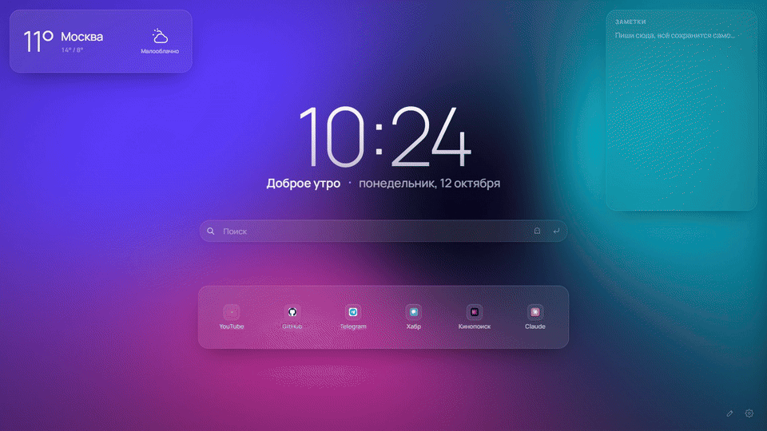
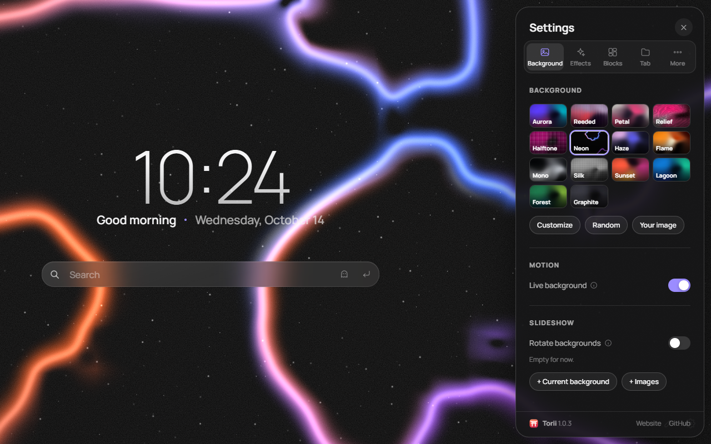
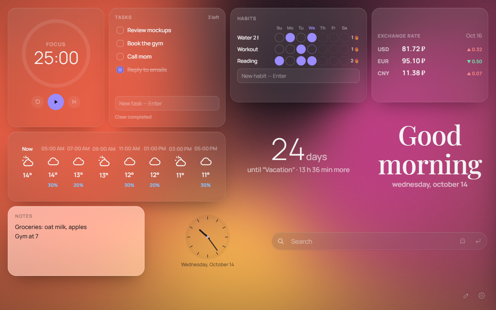

<p align="center"></p>

<h1 align="center">Torii</h1>

<p align="center">A new tab with a free-form layout: drag and resize widgets anywhere.<br>
Новая вкладка со свободной раскладкой: двигай и растягивай виджеты как хочешь.</p>

<p align="center">
  <a href="https://chromewebstore.google.com/detail/eimplcpjlibipimkmaipfkidbdagknof"><b>Chrome Web Store</b></a> ·
  <a href="https://addons.mozilla.org/firefox/addon/torii-new-tab/"><b>Firefox Add-ons</b></a> ·
  <a href="https://dvmnum.github.io/torii">Website</a> ·
  <a href="CHANGELOG.md">Changelog</a>
</p>

<p align="center">Free · open source · no ads · no analytics · no account</p>



## Why

Most new tab pages give you a fixed layout: a clock in the middle, a search bar under it, maybe a row of links. Torii is for people who want to arrange the page themselves — weather in a corner, notes on the right, the clock wherever it looks best — and make it look good.

## Features

- **Free-form layout** — drag widgets anywhere on a grid, resize them from any corner. Separate layouts for wide monitors and laptops.
- **Widgets** — clock (digital, duo, analog), search (your browser's default engine, `!yt`-style prefixes, a calculator, incognito), links, top sites, bookmarks bar (edit, reorder, iOS-like folders right on the tab), weather (now / details / hourly / week), notes, to-dos, habits, pomodoro, countdown, exchange rates, picture, recently closed tabs.
- **Live backgrounds** — animated WebGL gradients with 14 presets and a color editor, or your own image with effects (frosted glass, reeded, halftone, duotone), slideshow.
- **Glass** — frosted widgets that adapt to the background so text stays readable; "liquid glass" with refraction in Chromium browsers.
- **Right-click anything** — every widget has its own menu; custom icons (picture or color) for any link.
- **Saved layouts** — several versions of your new tab ("Work", "Home"…), each with its own widgets and style, switched with Alt+1…9.
- **Fast and private** — opens in ~100 ms, everything stays in your browser. Optional permissions (bookmarks, top sites, recent tabs) are requested only when you add that widget.
- **6 languages** — English, Russian, Spanish, German, French, Portuguese.

| | |
|---|---|
|  |  |

## Install

- **Chrome, Edge, Yandex Browser, Opera, Brave, Vivaldi** — [Chrome Web Store](https://chromewebstore.google.com/detail/eimplcpjlibipimkmaipfkidbdagknof)
- **Firefox** — [Firefox Add-ons](https://addons.mozilla.org/firefox/addon/torii-new-tab/)
- **From source** — `chrome://extensions` → Developer mode → **Load unpacked** → the `plitka/` folder.

Русский: Torii — новая вкладка со свободной раскладкой. Ставится из тех же магазинов, интерфейс на русском включается сам.

## Development

Vanilla JS and CSS, no build step and no frameworks: the files in `plitka/` are loaded as is (Manifest V3).

```bash
npm i
npx playwright install chromium firefox
npm test               # e2e smoke test in Chromium (screenshots → tests/shots/)
npm run test:firefox   # smoke test in the Firefox engine
npm run perf           # load time and long tasks
npm run i18n           # Russian strings missing an English translation
npm run build          # store packages → dist/torii-<version>-chrome.zip / -firefox.zip
npm run release        # upload to Firefox Add-ons via API (keys in .env, see store/release-setup.md)
npm run store          # store screenshots → store/screenshots/
npm run site           # website images → site/img/  (then npm run site:serve)
```

Project notes for contributors live in [`CLAUDE.md`](CLAUDE.md) (in Russian): data model, widget API, gotchas.

## How it's made

Torii is built with [Claude Code](https://claude.com/claude-code). The idea, design and every product decision are by [@dvmnum](https://github.com/dvmnum); most of the code was written by Claude.

## Support

Torii is free and ad-free. If you like it, you can support the author via Telegram on [Tribute](https://web.tribute.tg/d/RJo) (from Russia — on [Boosty](https://boosty.to/dvmnum/donate)).

## License

Copyright © 2026 dvmnum. The code is under the [GNU General Public License v3.0](LICENSE): you can use, study, change and share it, and anything you distribute that's built on it must stay open under the same license. Versions up to 0.12.4 were also released under MIT.

The name Torii and the icon (`plitka/icons/`, `site/img/icon.svg`) are not covered by the code license and remain © dvmnum. Forks must use their own name and artwork.

Bundled fonts (Manrope, Unbounded, Playfair Display, Oswald, Comfortaa, Caveat, Lobster) are under the SIL Open Font License; search engine and browser logos are from Simple Icons (CC0) and Font Awesome (CC BY 4.0); outline icons in the widget catalog are from Lucide (ISC); the grid is [gridstack.js](https://github.com/gridstack/gridstack.js) (MIT).
